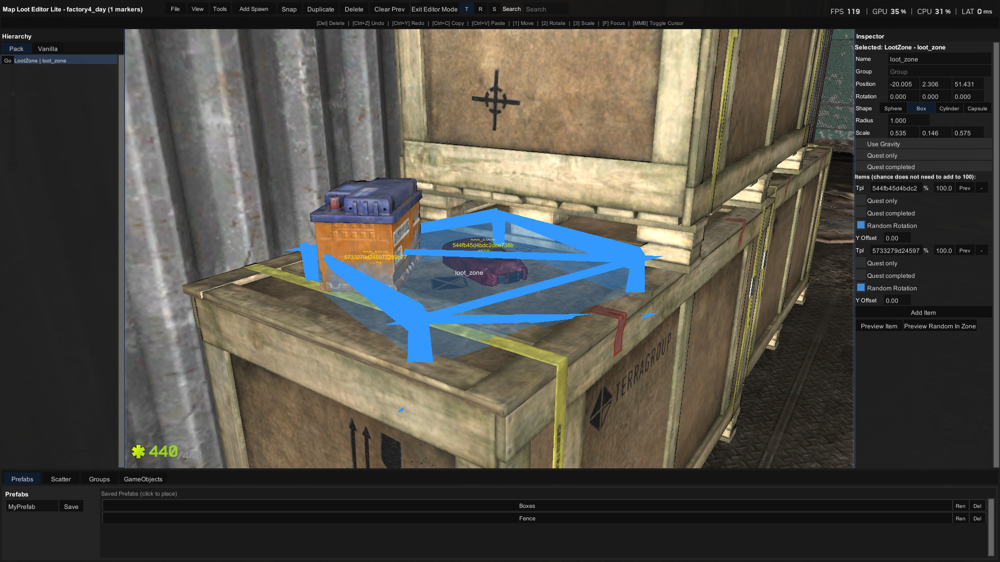
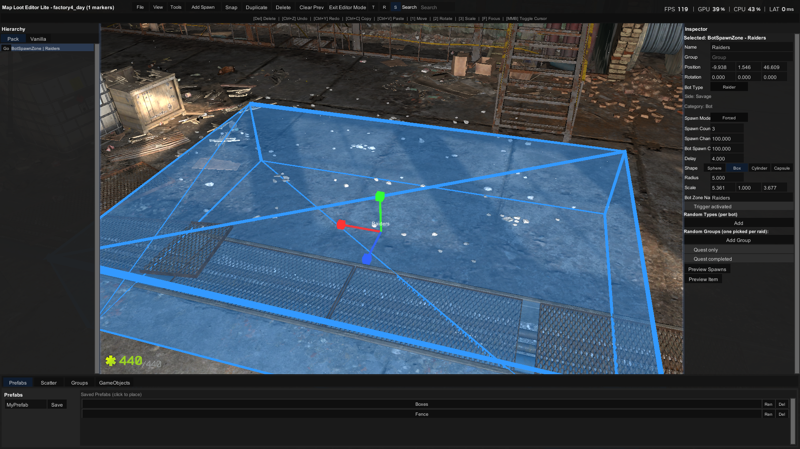
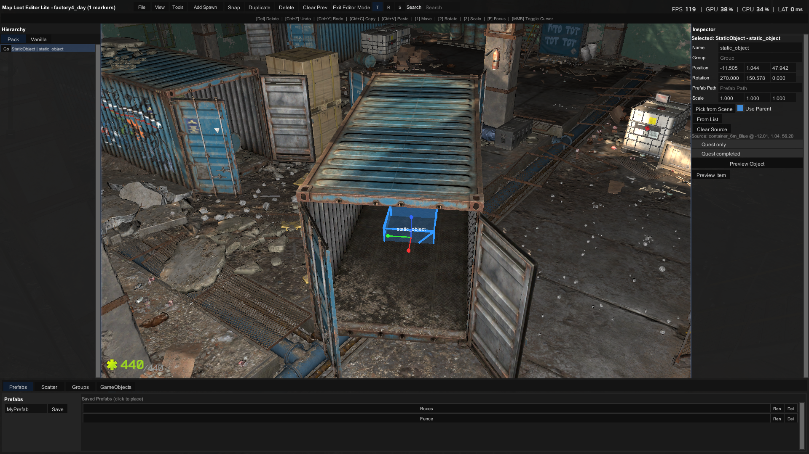
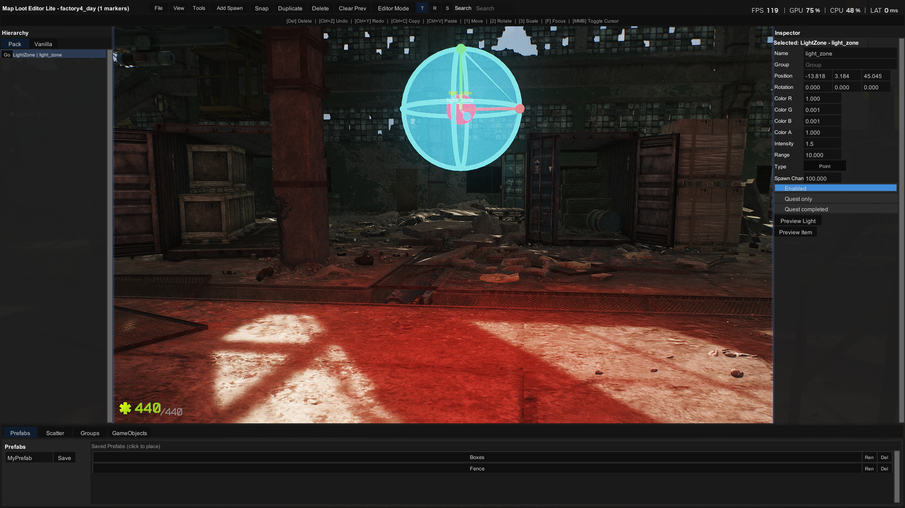

# Map Editor Lite - Custom Map Editor Framework

**Map Editor Lite** is a server-side framework for SPTarkov that lets anyone create and share custom map content - loot spawns, loot zones, static objects, interactive objects, bot spawn points, extract zones, and light zones - using an in-raid editor and simple JSON packs, no programming required.

## What It Does

- **In-raid editor**: press `F8` while in a raid to place markers, preview items, and build custom map packs.
- **Custom markers**: loot spawns, loot zones, static objects, interactive objects (doors & containers), bot spawn points, extract zones, and light zones.
- **Pack system**: export your map edits as shareable JSON packs.
- **Web tool**: import and tune exported packs, adjust spawn chances, mark quest/forced items, and finalize them for release.
- **Server injection**: the server mod reads pack JSON and injects the content into SPT raid loot tables, exfiltration points, bot zones, and lighting.
- **Forced spawns**: quest and guaranteed spawns are registered through **WTT-CommonLib**.
- **Modder friendly**: other mods can ship pack JSON files in their own `MapLoot/` folders; the server mod loads them automatically.

## Images






## Installation

1. Drag the `SPT` and `BepInEx` folders from the mod archive into your SPT installation directory.
2. Make sure **WTT-CommonLib** (`com.wtt.commonlib`) is installed as a server mod.
3. Start the server. Map Editor Lite loads automatically.

On first launch the client creates:

- `SPT/BepInEx/config/com.shaneeexd.mapeditorlite.cfg` — BepInEx configuration (editor toggle, hotkeys, etc.)
- `SPT/user/mods/MapEditorLite/` — client read/write data folder
  - `editor/`          # in-raid editor saves
  - `spawns/`          # built-in spawn directory
  - `imports/`         # files imported into the tool
  - `cache/`           # cached item data
  - `prefabs/`         # saved prefabs
  - `exports/`         # packs exported from the in-raid editor
  - `packs/`           # final user packs for the server to load

## Configuration

Edit `SPT/BepInEx/config/com.shaneeexd.mapeditorlite.cfg`:

```ini
[General]
EnableEditor = false
EnableDebugVisuals = false
```

- `EnableEditor` — set to `true` while developing. Default is `false`, so the F8 editor is disabled until you opt in.
- `EnableDebugVisuals` — show extra debug visuals in raid.

### Optional BotGen registry

MEL sends `POST /botgen/registry` with an empty JSON model (`{}`) using the backend
configured by the SPT launcher. No particular host, port, or HTTP/HTTPS scheme is assumed.
BotGen remains optional; the route is hosted by its SPT server mod, not a separate service.

```ini
[Integrations]
BotGenBackendUrl =
```

Leave `BotGenBackendUrl` empty for automatic discovery through `SPT.Common.Http.RequestHandler.Host`.
An advanced override can specify a **trusted SPT backend base URL**, including an optional
base path. SPT session credentials are forwarded to that backend. Only HTTP(S) URLs without
embedded credentials, query strings, or fragments are accepted. A pasted URL ending in
`/botgen/registry` is normalized so the route is appended only once.

On upgrade, the deprecated `BotGenRegistryUrl` is consumed and cleared. When the new override
is empty, the old `http://127.0.0.1:6969/botgen/registry` default becomes automatic discovery;
other old URLs migrate to backend overrides. A non-empty new override takes precedence.
Invalid custom settings produce a configuration failure, not a silent fallback.

MEL reuses SPT's `Client.CreateNewHttpRequest`, shared `HttpClient`, and zlib helpers for
session and framing compatibility. An override uses an owned instance of the same SPT client.
MEL adds JSON headers and a 12-second per-request cancellation deadline without changing
SPT's global client settings or certificate handling. It does not use SPT's convenience
`PostJsonAsync` wrapper because that wrapper hides HTTP status, omits the content type,
and immediately retries failures.

Plugin `Awake` does not prove backend readiness. Startup waits two realtime seconds, then
allows at most three attempts, with 10- and 30-second waits after failures. Each attempt sends
one request; there is no continuous registry polling. A manual **Refresh BotGen Registry**
supersedes any pending startup retry schedule. In-flight refreshes cannot overlap.

Logs identify the method, sanitized backend, path, automatic/override mode, HTTP status when
available, elapsed milliseconds, and failure classification. Native socket/WebException
codes and exception types are retained; exception messages/stacks and sensitive headers
are not logged because they can contain session details.

Failed transport or response validation preserves the last snapshot but disables its roles
until refresh succeeds. A fully validated empty registry clears selectable roles. Saved role
IDs and known labels remain intact; deleted, inactive, unregistered, or missing follower roles
cannot spawn and are never replaced with vanilla NPCs. After startup, refresh manually when
BotGen role readiness or definitions change.

#### Focused validation (no running server required)

From the repository root, using your installed SPT game directory:

```powershell
dotnet run --project 'Tests\BotGenRegistryChecks\BotGenRegistryChecks.csproj' -c Release '-p:SPTPath=E:\your-SPT-install'
dotnet build 'Client\Client.csproj' -c Release '-p:SPTPath=E:\your-SPT-install'
```

The console checks compile the production transport/provider code with isolated SPT/Unity
shims and the installed Newtonsoft.Json assembly. They exercise URL selection, request shape,
framing, diagnostics, snapshot validation, stale/deleted roles, overlap prevention and retry
scheduling without network access. The client build checks actual installed SPT API signatures.
Neither verifies live server middleware, TLS/session interoperability, Unity coroutine timing,
or the in-game inspector/spawner; those still require an in-game check. Building does not deploy DLLs.

## Creating a Map Pack

1. Install the client plugin and server mod.
2. Set `EnableEditor = true` in the BepInEx config.
3. Enter a raid and press `F8` to open the editor.
4. Place markers for loot, zones, objects, bot spawns, extracts, or lights.
5. Enter a pack name and click **Export Pack** in the editor.
6. The exported pack is written to `SPT/user/mods/MapEditorLite/exports/`.
7. Open the **Map Editor Lite Tool**, import the pack, tune spawn chances, and mark any quest items as **Forced (Quest)**.
8. Move the final pack into `SPT/user/mods/MapEditorLite/packs/` (or your own mod's `MapLoot/` folder).

> **Tip**: Always test on a new developer profile (and clear temp cache) so you can verify spawns, loot, extracts, and lighting without affecting your main save.

## Publishing a Pack

The final pack is a JSON file that can be distributed as a standalone add-on.

When publishing:

1. **State the dependency**: Your add-on pack requires **Map Editor Lite v1.1.0** for SPT 4.0.13.
2. **Do not include** the Map Editor Lite DLL or other authors' packs in your zip.
3. **Test** by extracting and running the server before publishing.

Users install your pack by dragging the `SPT` folder (containing `SPT\user\mods\MapEditorLite\packs`) into their SPT install.

## Dependencies

- SPTarkov 4.0.13
- WTT-CommonLib (server mod)

## More Information

View my framework mods and user created add-ons for them [here.](https://serenity-workshop.netlify.app)

- Full documentation, JSON reference, and examples are in the [GitHub README](https://github.com/ShaneeexD/MapLootEditorLite/blob/main/README.md).

## License

MIT License
